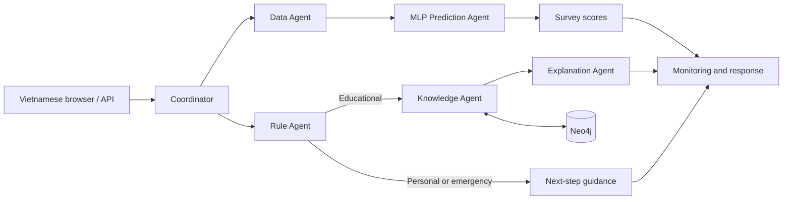

# Diabetes Hybrid Lab

An educational intelligent-systems project with an **English Jupyter Notebook and presentation material** and a **Vietnamese browser demo**. The system combines a retrospective survey classifier with a separate diabetes information assistant.

- [Executed Jupyter Notebook](notebooks/Diabetes_Hybrid_Lab.ipynb)
- [Vietnamese live demo guide](docs/DEMO_GUIDE_VI.md)
- [Presentation questions and answers](docs/PRESENTATION_QA.md)
- [Vietnamese web demo](http://127.0.0.1:8011/)
- [Neo4j Browser](http://127.0.0.1:7476/browser/)

## Project layout

| Path | Contents |
| --- | --- |
| `app.py`, `start_demo.ps1` | Web and local startup |
| `core/` | Coordination, agents, retrieval, and model inference |
| `knowledge_base/sources/` | Curated source bundles, one per URL |
| `knowledge_base/cypher/` | Generated Neo4j seed, live retrieval query, and demonstration queries |
| `experiments/`, `tests/` | Model training, artifact imports, and integration checks |
| `data/`, `artifacts/` | Datasets, checkpoints, metrics, and generated figures |
| `notebooks/`, `docs/` | Executable report, presentation guide, and reference documents |
| `templates/`, `static/`, `demo/` | Web templates, frontend assets, and demo screenshots |

## What can the assistant do?

It answers general questions about diabetes types, symptoms, common tests, screening, prevention, complications, and care preparation. A question such as “What about the tests?” can inherit the prior diabetes type if it is an explicit follow-up. The web separates **Question**, **Answer**, **Sources and evidence**, and **Next step**. It retains the dialogue in the open tab. A new page load or **Xóa hội thoại** clears it.

The system directs individualized test interpretation to a healthcare professional, dose and medication-change requests to the appropriate clinician or pharmacist, and explicit red-flag wording to emergency care guidance. These routes are conservative language rules. They have not been clinically validated and cannot safely rule out an emergency. The survey model is available only for simulated cases and its scores are separate from all conversational responses. It was trained to recover a self-reported survey label. Clinical diagnosis, medication decisions, and risk estimation for individuals require evidence and validation outside this project.

## Which model and datasets were used?

| Dataset | Records | Task | MLP test macro-F1 | ROC-AUC |
| --- | ---: | --- | ---: | ---: |
| Processed BRFSS 2015 | 253,680 | Three self-reported survey categories | 0.4237 | 0.7708 (macro OvR) |
| Diabetes A2 | 100,000 | Independent binary benchmark using the supplied label | 0.6056 | 0.6632 |
| UCI 130-US Hospitals | 101,766 | Recorded readmission within 30 days | 0.5227 | 0.6306 |

The default inference service uses the **original Assignment 4** BRFSS PyTorch MLP and its fitted scaler. Its layer widths are **21 → 64 → 32 → 3**, with ReLU in both hidden layers. The importer preserves every trained weight and checks score parity on two synthetic profiles. Assignment 4 reported macro-F1 **0.4252** and accuracy **0.6400** under its own evaluation protocol. [Provenance and parity checks](artifacts/assignment4_original.json)

The app also offers a separate grouped-evaluation MLP for the BRFSS row of the table above. It uses ReLU, dropout, AdamW, and weighted cross-entropy. The three groups contain 177,745 training rows, 37,997 validation rows, and 37,938 test rows. Identical feature profiles remain in the same split. Training-only preprocessing and validation macro-F1 selected epoch 9. Both models predict the same survey categories and produce uncalibrated softmax scores. Survey code 2 indicates reported diabetes, with no subtype information.

The two supplementary MLPs have independent encoders and hidden widths 32 and 16. The A2 run uses ten selected variables, omitting direct glucose measurements and potentially leaky columns such as the supplied risk score and diabetes stage. The provenance of the original A2 dataset has not been independently verified. The hospital run groups repeat encounters by patient. It concerns the historical encounters represented in the dataset.

On BRFSS, logistic regression has a macro-F1 of 0.4249 versus 0.4237 for the MLP, and a prediabetes recall of 0.3253 versus 0.2395. The majority baseline attains 0.8411 accuracy and zero recall for prediabetes. These results illustrate why per-class metrics matter. The demo retains Assignment 4 CNN benchmarks on MNIST and CIFAR-10 and the previous Pima benchmark separately. [Full metrics](http://127.0.0.1:8011/api/experiment)

[CDC BRFSS](https://www.cdc.gov/brfss/annual_data/annual_2015.html) · [Processed BRFSS table](https://www.kaggle.com/datasets/alexteboul/diabetes-health-indicators-dataset) · [A2 metadata source](https://www.kaggle.com/datasets/mohankrishnathalla/diabetes-health-indicators-dataset) · [UCI dataset](https://doi.org/10.24432/C5230J) · [MNIST](https://www.tensorflow.org/datasets/catalog/mnist) · [CIFAR-10](https://cave.cs.toronto.edu/kriz/cifar.html)

## Where are the knowledge graph and retrieval code?

The seed is [kb_diabet.cypher](knowledge_base/cypher/kb_diabet.cypher). The demo uses the existing local Neo4j graph, which contains 21 concepts, 27 passages, 22 sources, and 112 relationships. English is the default for Neo4j properties. The browser selects Vietnamese properties. The original evidence URL is preserved in both views.

Each URL has its own JSON bundle in [knowledge_base/sources](knowledge_base/sources/). There are **20 diabetes education web URLs**, a CDC codebook PDF, and a dataset metadata record. To update the knowledge base, edit the source bundle or taxonomy and run [build_kb.py](knowledge_base/build_kb.py). The builder checks duplicate URLs and IDs, valid topic references, and evidence for every semantic edge. It exports the combined [kb_diabetes.json](knowledge_base/kb_diabetes.json) and compiles the Cypher seed. The seed script checks that both exports match the bundles. Adding or updating a bundle can be imported with the existing seed. A removed bundle requires a clean dedicated database to remove old records.

The graph uses `(:Passage)-[:ABOUT]->(:Concept)` and `(:Passage)-[:FROM_SOURCE]->(:Source)`. Examples of semantic edges include `CLASSIFIED_WITH`, `ASSESSED_BY`, and `HAS_ACUTE_COMPLICATION`. Each semantic edge records its supporting passage. [Example queries](knowledge_base/cypher/examples.cypher) · [Live graph counts](http://127.0.0.1:8011/api/graph)

| Source | Use in the knowledge base |
| --- | --- |
| [WHO diabetes fact sheet](https://www.who.int/news-room/fact-sheets/detail/diabetes) | Common symptoms, type 2 prevention, and complications |
| [NIDDK tests and diagnosis](https://www.niddk.nih.gov/health-information/diabetes/overview/tests-diagnosis) | Diagnostic testing concepts and general HbA1c reference categories |
| [NIDDK gestational diabetes](https://www.niddk.nih.gov/health-information/diabetes/overview/what-is-diabetes/gestational/tests-diagnosis) | Antenatal screening and tests |
| [CDC hypoglycemia](https://www.cdc.gov/diabetes/about/low-blood-sugar-hypoglycemia.html) and [CDC ketoacidosis](https://www.cdc.gov/diabetes/about/diabetic-ketoacidosis.html) | Acute complications and warning signs |
| [CDC BRFSS Codebook PDF, page 21](https://www.cdc.gov/brfss/annual_data/2015/pdf/codebook15_llcp.pdf#page=21) | Original survey wording and provenance |
| [Vinmec](https://www.vinmec.com/vie/bai-viet/tieu-chuan-chan-doan-tieu-duong-type-1-vi) | Supplementary Vietnamese reading on type 1 |
| [FPT Long Chau: pregnancy](https://nhathuoclongchau.com.vn/benh/tieu-duong-thai-ky.html), [test preparation](https://nhathuoclongchau.com.vn/bai-viet/truoc-khi-xet-nghiem-tieu-duong-co-can-nhin-an-hay-khong.html), [monitoring](https://nhathuoclongchau.com.vn/bai-viet/nguoi-mac-dai-thao-duong-can-theo-doi-nhung-gi-ngoai-duong-huyet-de-tranh-bien-chung.html) | Supplementary local-language reading. The seed excludes commercial or product recommendations. |

[rag.py](core/rag.py) maps aliases to concept IDs and sends a parameterized [Cypher retrieval query](knowledge_base/cypher/retrieve.cypher). It uses direct links and semantic relationships with passage evidence. Candidates are ranked with character TF-IDF cosine similarity, topic matches, and a source-type signal. The answer is extracted from the highest-ranked passage and accompanied by source links. The implementation uses no language-model generator and no live web search at response time. In a conventional generative RAG system, the retrieved evidence becomes input to a generator and requires separate grounding checks.

## How does the multi-agent flow work?



The six layers in the specification map to the browser, Flask and data validation, Coordinator, specialized agents, model artifacts and Neo4j, and the request trace plus saved evaluation results. The request trace is returned with the result and is not a persistent patient record.

Agents pass `Message(request_id, agent, status, payload, evidence, version)` objects. For example, the Data Agent sends the ordered feature vector in its private payload, and the Prediction Agent sends scores and a model version to the Rule and Explanation agents. Monitoring publishes an independent projection with a summary, selected metadata, and elapsed time. Free-text questions and raw feature values are excluded from the trace.

Invalid synthetic input stops both branches. A missing optional question skips retrieval and allows the model report to complete. An offline Neo4j instance leaves the MLP branch available. The Explanation Agent returns a structured report with distinct `prediction`, `rules`, `knowledge`, `review`, and `limitations` fields. It requests professional review when the top two scores are close, a personal request needs clinical interpretation, or approved retrieved sources disagree on an identically scoped curated claim. The last check applies only to tagged assertions in the retrieved evidence. It does not infer disagreements from untagged prose or resolve which source is correct. The conflict tests use synthetic fixtures.

## How do I run or present it?

On the Windows development machine with saved Neo4j Desktop settings, start the `Diabetes` instance in Desktop and open a terminal in the project folder:

```powershell
python app1.py  # Vietnamese
python app2.py  # English, in a separate terminal
```

Open the [Vietnamese demo](http://127.0.0.1:8012/#demo) or the [English demo](http://127.0.0.1:8013/#demo). Both use the same model checkpoints and knowledge graph. The English demo retrieves the English passage fields in Neo4j. The `python app.py` command also starts the Vietnamese demo. The app reads the local connection settings from `%LOCALAPPDATA%\DiabetesHybridRuntime\neo4j-desktop.json`. PowerShell variables supplied for the same connection override the saved values. Use `DIABETES_PORT` for the Vietnamese port and `DIABETES_EN_PORT` for the English port.

On machines using the portable setup:

```powershell
./start_demo.ps1
```

Open the [Vietnamese demo](http://127.0.0.1:8011/). In chat mode, ask `Tiểu đường thai kỳ là gì?`, then `Còn xét nghiệm thì sao?`. The second question inherits the gestational diabetes topic. For the two-branch demonstration, use **Hồ sơ B**, select **Chẩn đoán tiểu đường type 1 bằng xét nghiệm nào?** and click **Chạy cả hai nhánh**. Show the survey scores, Vinmec/NIDDK evidence, and the trace. You can also enable manual entry for all 21 synthetic survey fields. The dashboard plots saved loss, accuracy, ROC, precision–recall, calibration, score distribution, and a reference-only retrieval check.

In [Neo4j Browser](http://127.0.0.1:7476/browser/), use `bolt://127.0.0.1:7689` and user `neo4j`. The local password was generated during setup and is stored in `%LOCALAPPDATA%\DiabetesHybridRuntime\neo4j-password.txt`. Run `:use neo4j` and paste a query from [neo4j/examples.cypher](knowledge_base/cypher/examples.cypher).

For a new installation, use Python 3.13 and a dedicated local [Neo4j and Java setup](https://neo4j.com/docs/operations-manual/current/installation/windows/). Set `NEO4J_URI`, `NEO4J_USER`, and `NEO4J_PASSWORD`. Optional variables are `NEO4J_DATABASE` and `NEO4J_BROWSER_URL`. From the project directory, run:

```powershell
python -m pip install -r requirements.txt
python -m knowledge_base.build_kb
python -m knowledge_base.seed
python app.py
```

For the notebook, use the same Python environment with `ipykernel` and `matplotlib`. Select the Python 3 kernel and **Run All**. The notebook reads saved metrics and runs live queries if Neo4j is available.

```powershell
python -m pip install jupyterlab matplotlib
python -m jupyterlab notebooks/Diabetes_Hybrid_Lab.ipynb
```

To reproduce the experiments and integration checks:

```powershell
python -m experiments.train
python -m experiments.train_additional
python -m tests.verify_demo
```

The packaged project includes the three input archives or CSV files under `data/`, along with both model checkpoints and the archived CNN and Pima metrics. To reimport the original model from locally supplied artifacts, run `python -m experiments.import_assignment4` in the course workspace or pass the path to Assignment 4's `DATA` directory. Restart the app after replacing a checkpoint. [Held-out BRFSS results](artifacts/experiment.json) · [Two supplementary runs](artifacts/additional_experiments.json) · [Retrieval and routing tests](artifacts/demo_verification.json)

Browser captures include the [two-turn chat](demo/05_chat_followup_vi.png), [emergency routing](demo/06_urgent_routing_vi.png), and [combined mode](demo/02_combined_vinmec.png).

